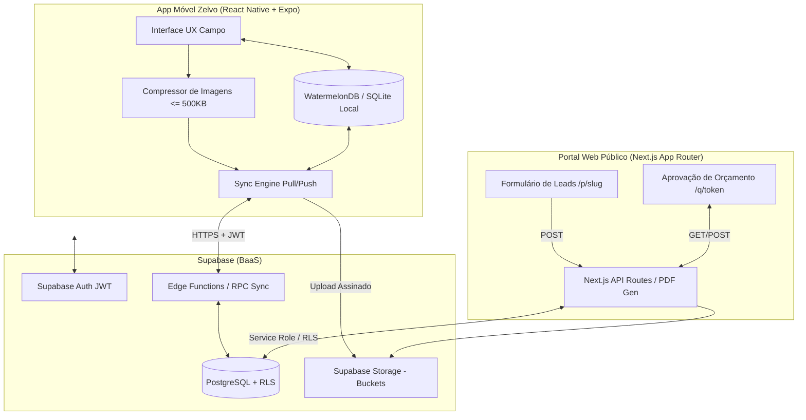

# 02-ARCHITECTURE: Arquitetura e Modelo de Dados (Zelvo)

## 1. Diagrama da Arquitetura do Sistema



---

## 2. Justificativa da Stack Tecnológica (Monorepo)
`[SUPOSIÇÃO]` Adota-se um **Monorepo com pnpm + Turborepo** para partilhar tipos TypeScript, esquemas de validação (Zod) e lógica de negócio entre o App Móvel e o Portal Web.

| Camada | Tecnologia | Justificativa |
| :--- | :--- | :--- |
| **App Móvel** | **React Native (Expo SDK 52+)** + TypeScript | Desenvolvimento rápido para iOS/Android, excelente suporte a câmara, *deep-links* (`wa.me`, Maps) e builds via EAS. |
| **Base Local (Offline)** | **WatermelonDB** (sobre SQLite) | Motor reativo e *lazy-loaded* desenhado especificamente para apps offline-first em React Native com protocolo de sincronização *delta* (`pull`/`push`). |
| **Portal Web** | **Next.js 15 (App Router)** + Tailwind CSS | Carregamento instantâneo para o cliente final (SSR), SEO para links públicos e *API Routes* para geração de PDFs (`@react-pdf/renderer`). |
| **Backend & BD** | **Supabase** (PostgreSQL + Auth + Storage) | *Free tier* generoso, suporte nativo a `JSONB` (essencial para multi-nicho), *Row-Level Security* (RLS) para multi-tenancy e Storage integrado. |
| **Validação** | **Zod** | Partilha de contratos de entrada/saída entre Mobile, Web e Backend. |

---

## 3. Esquema Completo do Banco de Dados (PostgreSQL)

> **Regra Global:** Todas as tabelas sincronizadas com o WatermelonDB possuem as colunas `created_at` (timestamptz), `updated_at` (timestamptz) e `deleted_at` (timestamptz, nullable — *soft delete* obrigatório para sincronização offline).

```sql
-- 1. Templates de Verticais (Global - Leitura pública autenticada)
CREATE TABLE vertical_templates (
  id UUID PRIMARY KEY DEFAULT gen_random_uuid(),
  slug TEXT UNIQUE NOT NULL, -- ex: 'jardinagem', 'piscinas'
  name TEXT NOT NULL,
  asset_schema JSONB NOT NULL DEFAULT '[]', -- Definição de campos dinâmicos do ServiceAsset
  default_services JSONB NOT NULL DEFAULT '[]',
  default_checklists JSONB NOT NULL DEFAULT '[]',
  feature_flags JSONB NOT NULL DEFAULT '{}',
  created_at TIMESTAMPTZ NOT NULL DEFAULT now()
);

-- 2. Organizações (Tenants)
CREATE TABLE organizations (
  id UUID PRIMARY KEY DEFAULT gen_random_uuid(),
  vertical_id UUID NOT NULL REFERENCES vertical_templates(id),
  name TEXT NOT NULL,
  slug TEXT UNIQUE NOT NULL, -- Usado no link público /p/[slug]
  nif TEXT,
  phone TEXT,
  email TEXT,
  logo_url TEXT,
  primary_color TEXT DEFAULT '#10B981',
  plan TEXT NOT NULL DEFAULT 'PILOT', -- PILOT, SOLO, TEAM
  created_at TIMESTAMPTZ NOT NULL DEFAULT now(),
  updated_at TIMESTAMPTZ NOT NULL DEFAULT now()
);

-- 3. Perfis de Utilizadores (Ligado a auth.users do Supabase)
CREATE TABLE users (
  id UUID PRIMARY KEY REFERENCES auth.users(id) ON DELETE CASCADE,
  organization_id UUID NOT NULL REFERENCES organizations(id) ON DELETE CASCADE,
  full_name TEXT NOT NULL,
  role TEXT NOT NULL DEFAULT 'ADMIN' CHECK (role IN ('ADMIN', 'TECHNICIAN')),
  created_at TIMESTAMPTZ NOT NULL DEFAULT now(),
  updated_at TIMESTAMPTZ NOT NULL DEFAULT now()
);

-- 4. Leads (Funil Comercial)
CREATE TABLE leads (
  id UUID PRIMARY KEY DEFAULT gen_random_uuid(),
  organization_id UUID NOT NULL REFERENCES organizations(id) ON DELETE CASCADE,
  name TEXT NOT NULL,
  phone TEXT NOT NULL,
  email TEXT,
  address TEXT,
  description TEXT,
  source TEXT NOT NULL DEFAULT 'WEB_FORM', -- WEB_FORM, MANUAL, WHATSAPP
  status TEXT NOT NULL DEFAULT 'NEW' CHECK (status IN ('NEW', 'VISIT_SCHEDULED', 'QUOTE_SENT', 'WON', 'LOST')),
  lost_reason TEXT,
  photo_urls JSONB NOT NULL DEFAULT '[]',
  gdpr_consent BOOLEAN NOT NULL DEFAULT false,
  gdpr_consent_at TIMESTAMPTZ,
  created_at TIMESTAMPTZ NOT NULL DEFAULT now(),
  updated_at TIMESTAMPTZ NOT NULL DEFAULT now(),
  deleted_at TIMESTAMPTZ
);

-- 5. Clientes (CRM)
CREATE TABLE clients (
  id UUID PRIMARY KEY DEFAULT gen_random_uuid(),
  organization_id UUID NOT NULL REFERENCES organizations(id) ON DELETE CASCADE,
  lead_id UUID REFERENCES leads(id) ON DELETE SET NULL,
  name TEXT NOT NULL,
  phone TEXT NOT NULL,
  email TEXT,
  nif TEXT,
  billing_address TEXT,
  notes TEXT,
  is_anonymized BOOLEAN NOT NULL DEFAULT false, -- Suporte RGPD
  created_at TIMESTAMPTZ NOT NULL DEFAULT now(),
  updated_at TIMESTAMPTZ NOT NULL DEFAULT now(),
  deleted_at TIMESTAMPTZ
);

-- 6. Ativos / Locais de Serviço (Multi-Nicho)
CREATE TABLE service_assets (
  id UUID PRIMARY KEY DEFAULT gen_random_uuid(),
  organization_id UUID NOT NULL REFERENCES organizations(id) ON DELETE CASCADE,
  client_id UUID NOT NULL REFERENCES clients(id) ON DELETE CASCADE,
  name TEXT NOT NULL, -- ex: "Jardim Principal", "Casa de Férias"
  address TEXT NOT NULL,
  latitude DOUBLE PRECISION,
  longitude DOUBLE PRECISION,
  access_notes TEXT, -- código portão, cães, torneira
  custom_attributes JSONB NOT NULL DEFAULT '{}', -- ex: {"area_m2": 150, "tipo_relva": "Natural"}
  created_at TIMESTAMPTZ NOT NULL DEFAULT now(),
  updated_at TIMESTAMPTZ NOT NULL DEFAULT now(),
  deleted_at TIMESTAMPTZ
);

-- 7. Catálogo de Serviços e Insumos
CREATE TABLE service_catalog (
  id UUID PRIMARY KEY DEFAULT gen_random_uuid(),
  organization_id UUID NOT NULL REFERENCES organizations(id) ON DELETE CASCADE,
  name TEXT NOT NULL,
  description TEXT,
  unit TEXT NOT NULL DEFAULT 'FIXED' CHECK (unit IN ('FIXED', 'HOUR', 'SQM', 'UNIT')),
  unit_price NUMERIC(10, 2) NOT NULL DEFAULT 0,
  cost_price NUMERIC(10, 2) NOT NULL DEFAULT 0,
  vat_rate NUMERIC(5, 2) NOT NULL DEFAULT 23.00, -- IVA padrão Portugal
  created_at TIMESTAMPTZ NOT NULL DEFAULT now(),
  updated_at TIMESTAMPTZ NOT NULL DEFAULT now(),
  deleted_at TIMESTAMPTZ
);

-- 8. Orçamentos
CREATE TABLE quotes (
  id UUID PRIMARY KEY DEFAULT gen_random_uuid(),
  organization_id UUID NOT NULL REFERENCES organizations(id) ON DELETE CASCADE,
  lead_id UUID REFERENCES leads(id) ON DELETE SET NULL,
  client_id UUID REFERENCES clients(id) ON DELETE SET NULL,
  public_token TEXT UNIQUE NOT NULL, -- Token criptográfico para /q/[token]
  quote_number TEXT NOT NULL, -- ex: ORC-2026-001
  status TEXT NOT NULL DEFAULT 'DRAFT' CHECK (status IN ('DRAFT', 'SENT', 'APPROVED', 'REJECTED', 'EXPIRED')),
  items JSONB NOT NULL DEFAULT '[]', -- [{name, qty, unit_price, vat_rate, total}]
  subtotal NUMERIC(10, 2) NOT NULL DEFAULT 0,
  vat_total NUMERIC(10, 2) NOT NULL DEFAULT 0,
  total NUMERIC(10, 2) NOT NULL DEFAULT 0,
  valid_until DATE,
  approved_at TIMESTAMPTZ,
  approved_ip TEXT,
  created_at TIMESTAMPTZ NOT NULL DEFAULT now(),
  updated_at TIMESTAMPTZ NOT NULL DEFAULT now(),
  deleted_at TIMESTAMPTZ
);

-- 9. Serviços / Visitas (Agenda e Execução)
CREATE TABLE jobs (
  id UUID PRIMARY KEY DEFAULT gen_random_uuid(),
  organization_id UUID NOT NULL REFERENCES organizations(id) ON DELETE CASCADE,
  client_id UUID NOT NULL REFERENCES clients(id) ON DELETE CASCADE,
  asset_id UUID NOT NULL REFERENCES service_assets(id) ON DELETE CASCADE,
  quote_id UUID REFERENCES quotes(id) ON DELETE SET NULL,
  assigned_user_id UUID REFERENCES users(id) ON DELETE SET NULL,
  title TEXT NOT NULL,
  status TEXT NOT NULL DEFAULT 'SCHEDULED' CHECK (status IN ('SCHEDULED', 'IN_PROGRESS', 'COMPLETED', 'CANCELLED')),
  scheduled_start TIMESTAMPTZ NOT NULL,
  scheduled_end TIMESTAMPTZ,
  recurrence_rule TEXT, -- Formato iCal RRULE (ex: FREQ=WEEKLY;INTERVAL=2)
  parent_job_id UUID REFERENCES jobs(id) ON DELETE SET NULL,
  checkin_at TIMESTAMPTZ,
  checkout_at TIMESTAMPTZ,
  checklist JSONB NOT NULL DEFAULT '[]', -- [{id, label, done}]
  next_visit_notes TEXT,
  price NUMERIC(10, 2) NOT NULL DEFAULT 0,
  payment_status TEXT NOT NULL DEFAULT 'PENDING' CHECK (payment_status IN ('PENDING', 'PAID', 'PARTIAL')),
  created_at TIMESTAMPTZ NOT NULL DEFAULT now(),
  updated_at TIMESTAMPTZ NOT NULL DEFAULT now(),
  deleted_at TIMESTAMPTZ
);

-- 10. Multimédia de Visitas (Fotos Antes/Depois)
CREATE TABLE job_media (
  id UUID PRIMARY KEY DEFAULT gen_random_uuid(),
  organization_id UUID NOT NULL REFERENCES organizations(id) ON DELETE CASCADE,
  job_id UUID NOT NULL REFERENCES jobs(id) ON DELETE CASCADE,
  media_type TEXT NOT NULL CHECK (media_type IN ('BEFORE', 'AFTER', 'ISSUE')),
  storage_path TEXT NOT NULL,
  taken_at TIMESTAMPTZ NOT NULL DEFAULT now(),
  created_at TIMESTAMPTZ NOT NULL DEFAULT now(),
  updated_at TIMESTAMPTZ NOT NULL DEFAULT now(),
  deleted_at TIMESTAMPTZ
);

-- 11. Transações Financeiras (Entradas e Saídas)
CREATE TABLE transactions (
  id UUID PRIMARY KEY DEFAULT gen_random_uuid(),
  organization_id UUID NOT NULL REFERENCES organizations(id) ON DELETE CASCADE,
  job_id UUID REFERENCES jobs(id) ON DELETE SET NULL,
  client_id UUID REFERENCES clients(id) ON DELETE SET NULL,
  type TEXT NOT NULL CHECK (type IN ('INCOME', 'EXPENSE')),
  category TEXT NOT NULL, -- ex: 'SERVICE_PAYMENT', 'FUEL', 'MATERIALS', 'MAINTENANCE'
  amount NUMERIC(10, 2) NOT NULL,
  payment_method TEXT DEFAULT 'CASH' CHECK (payment_method IN ('CASH', 'MBWAY', 'MULTIBANCO', 'TRANSFER', 'CARD', 'OTHER')),
  transaction_date DATE NOT NULL DEFAULT CURRENT_DATE,
  description TEXT,
  receipt_path TEXT,
  external_payment_id TEXT, -- Preparado para Fase 2 (Ifthenpay/Stripe)
  external_invoice_id TEXT, -- Preparado para Fase 3 (Moloni/InvoiceXpress)
  created_at TIMESTAMPTZ NOT NULL DEFAULT now(),
  updated_at TIMESTAMPTZ NOT NULL DEFAULT now(),
  deleted_at TIMESTAMPTZ
);
```

---

## 4. Estrutura de Pastas Recomendada (Monorepo)

```text
zelvo/
├── apps/
│   ├── mobile/                  # React Native + Expo
│   │   ├── app/                 # Expo Router (Bottom Tabs: hoje, leads, clientes, financas)
│   │   ├── src/
│   │   │   ├── db/              # Schema WatermelonDB, Models e Sync Engine
│   │   │   ├── components/      # Botões >= 48dp, Cards de alto contraste
│   │   │   ├── services/        # Compressor de imagem, Deep-links (WhatsApp/Maps)
│   │   │   └── hooks/           # useOfflineSync, useOrganization
│   │   └── app.json
│   └── web/                     # Next.js 15 (Portal Cliente + API)
│       ├── app/
│       │   ├── p/[slug]/        # Formulário público de captação de leads
│       │   ├── q/[token]/       # Visualização e aprovação de orçamentos
│       │   └── api/             # Endpoints públicos e geração de PDF
│       └── components/
├── packages/
│   ├── shared/                  # Tipos TypeScript, Schemas Zod, Constantes e Lógica RRULE
│   └── pdf/                     # Templates @react-pdf/renderer para Orçamentos
├── supabase/
│   ├── migrations/              # Ficheiros SQL (Tabelas, Índices, RLS, RPCs de Sync)
│   ├── seed.sql                 # Seed com VerticalTemplate de Jardinagem
│   └── functions/               # Supabase Edge Functions (se necessário)
├── docs/                        # 01-PRD.md a 05-TEST-PLAN.md
├── package.json
└── turbo.json
```
