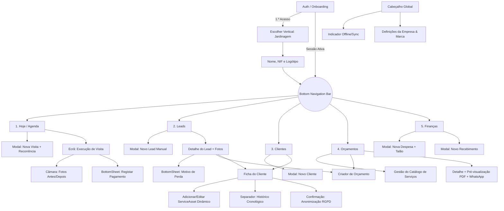

# 06-UX-NAVIGATION: Experiência do Utilizador, Arquitetura de Informação e Navegação (Zelvo)

Este documento define a arquitetura de informação, os fluxos de navegação, as regras de ergonomia em campo e os estados de interface do **Zelvo** (App Móvel + Portal Web Público).

---

## 1. Princípios de UX de Campo (Field-First)

1. **Operação com Uma Mão (Zona do Polegar):** Todas as ações primárias (Check-in, Concluir, Adicionar, Navegar) ficam posicionadas no terço inferior do ecrã ou em *Bottom Sheets*, com alvos de toque mínimos de `48x48dp`.
2. **Regra dos 3 Toques no Terreno:** Fechar uma visita concluída (Check-out + Checklist + Registo de Pagamento) não deve exigir mais de 3 interações principais nem escrita longa.
3. **Zero Bloqueio Offline:** O utilizador nunca vê um ecrã de "Sem Ligação à Internet" que o impeça de trabalhar. O estado offline é comunicado de forma passiva e tranquilizadora ("Modo Offline • X alterações guardadas localmente").
4. **Legibilidade Sob Luz Solar Direta:** Prioridade ao modo claro de alto contraste (WCAG AAA) durante o dia, sem dependência de sombras subtis ou texto cinzento claro para distinguir elementos.
5. **Zero Fricção para o Cliente Final:** O cliente final nunca instala uma app nem cria palavra-passe; todas as interações acontecem em links web móveis rápidos (`/p/[slug]` e `/q/[token]`).

---

## 2. Arquitetura de Informação e Mapa de Navegação

### 2.1 App Móvel (Expo Router — Bottom Tabs + Stacks)

### 2.2 Portal Web Público (Next.js App Router)

| Rota | Acesso | Objetivo do Utilizador | Próximo Passo |
| :--- | :--- | :--- | :--- |
| `/p/[slug]` | Público (QR Code / Bio Instagram) | Preencher pedido de orçamento com até 5 fotos e consentimento RGPD. | Ecrã de confirmação + botão opcional para contactar via WhatsApp. |
| `/q/[token]` | Link Privado (enviado por WhatsApp) | Consultar itens, IVA e total do orçamento com a marca do profissional. | Descarregar PDF ou clicar em **"Aprovar Orçamento"** (1 clique). |

---

## 3. Fluxos de Utilizador Críticos (User Flows)

### Fluxo A: Execução de Visita no Terreno (Offline-First)
1. **Abertura (`Hoje`):** O profissional vê a lista de visitas do dia ordenadas por hora. Cada cartão mostra imediatamente alertas críticos (ex.: *"Notas da última visita"* e *"Código do portão"*).
2. **Deslocação:** Toca em **Navegar** → abre diretamente Google Maps ou Waze.
3. **Chegada:** Toca no cartão da visita → toca em **Iniciar Serviço (Check-in)**. O cronómetro arranca e o estado muda para `IN_PROGRESS` (gravado no WatermelonDB).
4. **Execução:** Marca os itens do checklist com um toque; tira fotos **Antes** e **Depois** (compressão automática `<= 500 KB` sem interromper o utilizador); adiciona nota opcional para a próxima visita.
5. **Fecho:** Toca em **Concluir Serviço (Check-out)**.
6. **Cobrança Imediata:** Abre-se automaticamente um *Bottom Sheet* com o valor pré-preenchido perguntando: *"Recebeu o pagamento agora?"* → **Sim (Escolher método: Numerário / MB WAY / Transferência)** ou **Fica Pendente**.

### Fluxo B: Captação de Lead → Aprovação → Cliente
1. **Entrada:** Cliente submete `/p/[slug]` no telemóvel com fotos do jardim.
2. **Triagem:** Lead aparece no topo da coluna/filtro **Novo Pedido** no app do profissional com badge numérico no separador `Leads`.
3. **Proposta:** Profissional abre o lead, revê as fotos e toca em **Criar Orçamento**. Seleciona serviços do catálogo, revê o total com IVA e toca em **Enviar por WhatsApp** (`wa.me` com link `/q/[token]`). O lead passa automaticamente para **Orçamento Enviado**.
4. **Aprovação:** Cliente abre o link e clica em **Aprovar Orçamento**.
5. **Conversão:** No app do profissional, o orçamento aparece como **Aprovado** e o lead passa a **Fechado (Ganho)**, apresentando o botão de 1 clique **"Agendar 1.ª Visita"** (já com `Client` e `ServiceAsset` criados).

### Fluxo C: Tratamento de Lead Perdido
1. Profissional muda o estado do lead para **Perdido**.
2. Um *Bottom Sheet* obrigatório pede o motivo (*Preço*, *Prazo*, *Fora de zona*, *Sem resposta*, *Outro*).
3. Só após selecionar o motivo é que a alteração é confirmada.

---

## 4. Estados de Interface e Feedback

| Estado | Comportamento Obrigatório |
| :--- | :--- |
| **Offline / Pendente de Sync** | Barra fina discreta abaixo do cabeçalho em âmbar suave (`#FEF3C7` / texto `#92400E`): *"Offline • 2 alterações por sincronizar"*. Nunca bloqueia botões. |
| **A Sincronizar** | Ícone discreto rotativo no cabeçalho + confirmação rápida *"Tudo sincronizado"* (2 segundos) ao concluir. |
| **Empty State (Lista Vazia)** | Ilustração/ícone minimalista + frase clara orientada à ação + botão primário grande (ex.: *"Ainda não tem visitas hoje"* → `[+ Agendar Visita]`). |
| **Loading (Carregamento)** | *Skeletons* nas listas web (`/q/[token]`). No mobile, como a leitura é local (WatermelonDB), o carregamento deve ser instantâneo (`< 100ms`). |
| **Ações Destrutivas / RGPD** | Modal de confirmação explícito em vermelho (`#DC2626`) explicando o impacto (ex.: *"Anonimizar cliente apaga os dados pessoais mas mantém o histórico financeiro"*). |
| **Feedback de Sucesso** | *Toast* flutuante acima da barra inferior (duração 2.5s) com opção "Desfazer" quando aplicável. |
